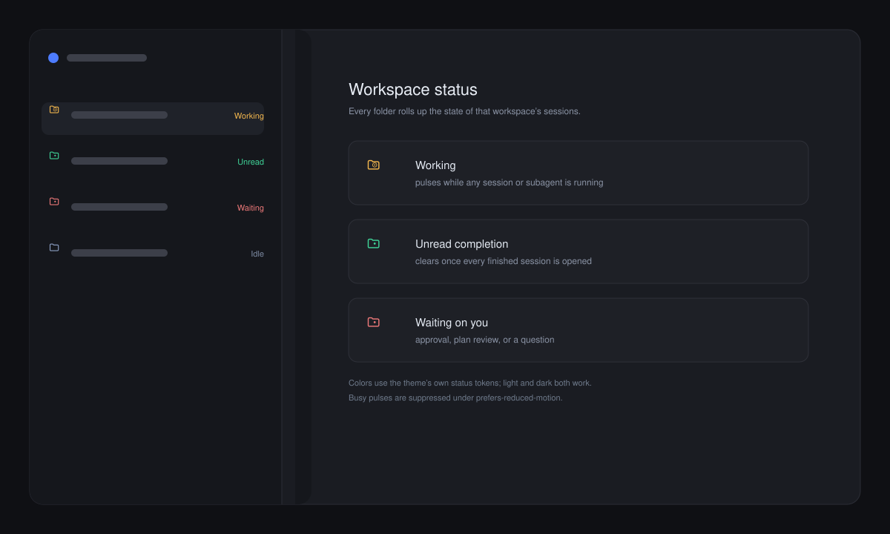

#  Workspace Status

**A DeepSeek Harness plugin that colors each workspace folder by what its
sessions are doing.**

Workspace Status rolls the state of every session in a workspace into one
folder glyph in the sidebar: red while something waits on you, pulsing amber
while work runs, green while a finished session's completion is still unread.
It reads the same statuses the session rows already use, so there is no extra
state to maintain.

## What you get

- **Red folder** — a session waits for your approval, plan review, or answer.
- **Pulsing amber folder** — any session, or one of its direct subagents, is
  running.
- **Green folder** — a session finished while you were not looking; it clears
  once every finished session in that workspace has been opened.
- **Ungrouped sessions** — the bucket for sessions outside every workspace
  follows the same rule.

## How it decides

Each workspace resolves to the busiest state among its visible sessions, with
**red → amber → green** precedence. Amber covers both a running parent and its
running direct subagents, so a session waiting on subagents stays busy until
they finish. Green is the same unread-completion reminder the session rows
show; opening a session acknowledges it, and the folder returns to its normal
color when the last unread session in that workspace is opened.

Archived, blank, and subagent conversations do not speak for a workspace.
Subagent work reaches its parent through the running child count — the same
direct children the header subagent dropdown lists. External tasks in the
catalog never count as running. Busy pulses are suppressed under
`prefers-reduced-motion`.

## Technical notes

- **Host coupling:** DSH does not yet expose a slot for decorating a workspace
  header row, so the layer paints the shipped folder glyph through
  `data-row-key="workspace:<id>"`. If that markup changes, the layer stops
  painting and folders return to their normal colors; nothing else breaks.
- **One source of truth:** the rollup reads the shipped Session status and
  Workspace snapshots; `completionUnread` is the same green reminder the
  session rows use, and main-view retention acknowledges it.
- **Theme-native colors:** folder colors use the theme's own error, warning,
  and success tokens, so light and dark themes both work. The existing glyph is
  recolored in place — the open/closed folder shape and the hover chevron stay
  intact.
- **Preference:** one switch in **Settings → General → Workspace Status**,
  stored in `localStorage` under `dsh.workspace-status.settings.v1` and migrated
  from earlier keys.
- **Limit:** an approval requested inside a subagent's own conversation shows
  amber (the parent is busy) rather than red; only a workspace session's own
  pending approval/question is red.

## Install

1. In DSH, open **Plugins → Add plugin**.
2. Enter `https://github.com/awychoi/dsh-workspace-status`, or the absolute path
   to a local checkout.
3. Enable the bundle. The sidebar's workspace folders recolor as sessions run,
   finish, or wait for you.

## Uninstall

Remove **Workspace Status** from DSH's plugin list and restart DSH. The folder
glyph returns to its normal color, and the switch remains in `localStorage`
only.

## Assets

`icon.svg` is the plugin icon. `icon-white.svg` is the transparent solid-white
mark for dark backgrounds. Exported as `./icon` and `./icon-white`.

## License

MIT. Copyright © 2026 awychoi.

Not affiliated with DeepSeek.
